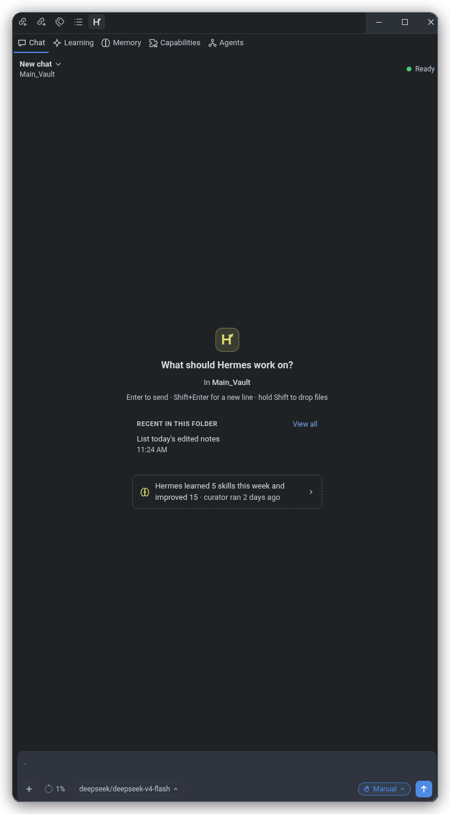
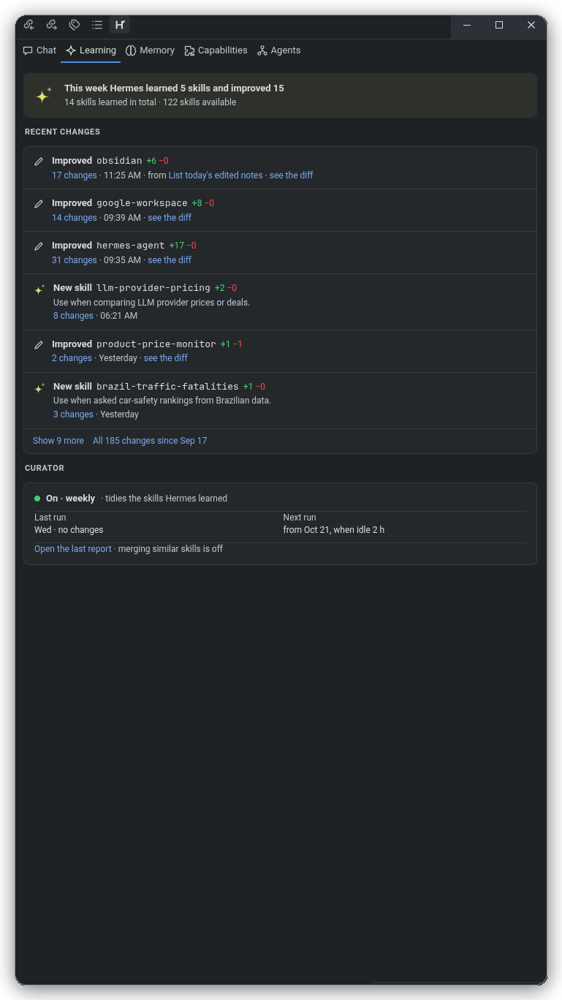

# Hermes Studio for Obsidian (`rea-hermes-studio`)

> **Hermes Studio** AI chat, workspace assistant, and diff workbench brought seamlessly into **Obsidian.md**.

A reverse-engineered, standalone port of the VSCode [Hermes Studio](https://marketplace.visualstudio.com/items?itemName=jefuriiij.hermes-studio) extension to Obsidian, engineered using patterns extracted from both Hermes Studio and Obsidian Copilot.

---

## 📸 Screenshots

| AI Chat & Context Workbench | Learning & Skills Hub |
| :---: | :---: |
|  |  |

---

## ✨ Features

- **Obsidian Theme Harmony:** Seamlessly adapts to Obsidian's active theme (dark/light, accent colors, typography, background variables) via dynamic CSS variable injection into an isolated Shadow DOM.
- **Svelte 5 Reactive Webview:** Fast, fluid, modern UI architecture mounted inside an Obsidian View or floating Modal dialog.
- **VSCode API Bridge for Obsidian:** Complete compatibility shim that maps VSCode editor and workspace primitives to Obsidian's `App`, `Vault`, and `WorkspaceLeaf`:
  - Active note tracking and real-time selection updates.
  - Contextual markdown insertions and active editor line navigation.
  - Bidirectional WikiLink (`[[Note]]`) and Obsidian URL scheme (`obsidian://open?vault=...&file=...`) generation.
- **Unified Diff Engine & Workbench:** Side-by-side and unified diff visualization for AI-generated code and note edits before applying changes.
- **Dual Display Modes:**
  - **Sidebar / Right Leaf View:** Keep Hermes Studio docked alongside your notes for persistent conversational context and references.
  - **Floating Modal View:** Quick pop-out assistant callable anytime with a hotkey command (`Hermes Studio: Open assistant modal`).
- **Flexible AI Endpoint Integration:** Configurable server host and port (defaulting to `http://localhost:8080`), API keys, model selections, and custom temperature settings.

---

## 🏗️ Architecture

```
src/
├── core/
│   ├── hermes-bridge.ts         # Bidirectional postMessage event protocol
│   ├── hermes-core.ts           # State machine, chat history & engine
│   └── unified-diff-view.ts     # LCS / Line diff visualizer & chunk applicator
├── host/
│   ├── note-tracker.ts          # Active file watcher & selection listener
│   ├── obsidian-host.ts         # VSCode Workspace/Window API shim for Obsidian
│   └── wikilink-resolver.ts     # Markdown link & Obsidian URI handler
├── plugin/
│   ├── hermes-modal.ts          # Floating pop-out modal view
│   ├── hermes-view.ts           # Dockable Sidebar WorkspaceLeaf view
│   └── settings-tab.ts          # Plugin settings UI in Obsidian options
├── webview/
│   ├── obsidian-theme-bridge.ts # Syncs Obsidian CSS vars into Webview Shadow DOM
│   └── svelte-mount.ts          # Svelte 5 Webview component lifecycle mount
├── main.ts                      # Plugin entrypoint & lifecycle manager
└── types.ts                     # Protocol and Host type definitions
```

---

## 🚀 Getting Started

### Prerequisites

- [Node.js](https://nodejs.org/) (v18+)
- [Obsidian](https://obsidian.md/) (v1.5.0+)

### Building from Source

1. Clone this repository:
   ```bash
   git clone https://github.com/6qat/rea-hermes-studio.git
   cd rea-hermes-studio
   ```

2. Install dependencies:
   ```bash
   npm install
   ```

3. Build the plugin:
   ```bash
   npm run build
   ```

4. Run unit and integration tests:
   ```bash
   npm test
   ```

---

## 📥 Installation in Obsidian

1. Create a `hermes-studio` folder in your Obsidian vault's plugin directory:
   ```bash
   mkdir -p /path/to/your/vault/.obsidian/plugins/hermes-studio
   ```
2. Copy `main.js`, `manifest.json`, and `styles.css` into that directory:
   ```bash
   cp main.js manifest.json styles.css /path/to/your/vault/.obsidian/plugins/hermes-studio/
   ```
3. Open Obsidian, go to **Settings → Community Plugins**, reload plugins, and enable **Hermes Studio**.

---

## ⌨️ Commands

- `Hermes Studio: Open sidebar view` - Opens or focuses the Hermes Studio assistant in the right sidebar.
- `Hermes Studio: Open assistant modal` - Displays the assistant in a modal overlay over your active note.
- `Hermes Studio: Insert active note context` - Sends current file content and highlighted text into the assistant session.

---

## 🧪 Testing

Comprehensive test suites verify the host API shim, vault and adapter compliance, note tracking, diff generation, and WikiLink resolution:

```bash
npm test
```

All 11 tests across all test suites are automated with Vitest.

---

## 🚀 Releasing

Bump `version` in `manifest.json` (and `package.json`), commit, then:

```bash
npm run release
```

The script tags the current version as `v<version>` and pushes it, which triggers the release workflow. Push **only** the `v*` tag — an unprefixed duplicate tag fires a second workflow run and creates a duplicate GitHub release.

---

## 🔒 Security & System Permissions

Hermes Studio is configured with `"isDesktopOnly": true` and adheres strictly to Obsidian's Developer Policies:

- **Obsidian Vault & DataAdapter APIs (`app.vault` & `app.vault.adapter`)**:
  - **All vault file interactions** (reading note contents, listing files, tracking note creation/modification/deletion events, resolving WikiLinks, and displaying diffs) are executed through Obsidian's official `Vault` and `DataAdapter` APIs. This preserves Obsidian's in-memory caching, atomic write safety, and full compatibility with Obsidian Sync.
- **Child Process Execution (`child_process`)**:
  - **Hermes Agent CLI (`hermes acp`)**: Spawns the local `hermes` CLI binary via `child_process.spawn()` to communicate with the local agent daemon over standard input/output (`stdio`) via the Agent Client Protocol (ACP). The CLI path is user-configurable in plugin settings (`hermesStudio.path`).
  - **Git Diff Inspection (`git diff`)**: Spawns `git` via `child_process.spawnSync()` exclusively with fixed argument arrays (`["diff"]` or `["diff", "--cached"]`) inside Git-versioned vaults to display unified diff proposals.
  - **Interactive Terminal Launches**: Spawns the user's preferred desktop terminal emulator (e.g. `gnome-terminal`, `kitty`, `alacritty`, `Terminal.app`) passing discrete command arguments strictly when the user requests interactive model setup (`hermes model`) or memory review (`hermes /memory`).
  - **Command Injection Prevention**: All process executions pass discrete string argument arrays (`args: string[]`) directly to executables without shell interpretation (`shell: false`). No unvalidated shell strings or remote shell scripts are ever executed.
- **External Filesystem Access (`fs` / `fs/promises`)**:
  - **Scoped strictly outside the Obsidian vault**: Direct filesystem access via Node.js `fs` is used solely to interact with the external Hermes Agent configuration, memories, and skills located in the user's home directory (`~/.hermes/` or `$HERMES_HOME`), and to verify the path of the local `hermes` CLI binary. No vault files are modified or read using raw `node:fs`.
- **Clipboard Access (`navigator.clipboard`)**:
  - Used exclusively when the user clicks the "Copy" action button on AI chat responses, code blocks, or prompt templates.

---

## 📜 License

MIT License. Designed and reverse-engineered with REA.
