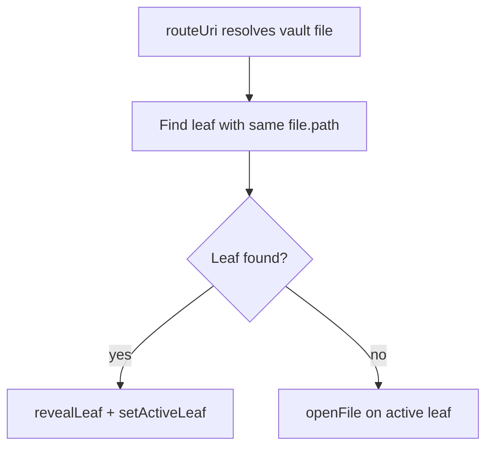

# Reuse existing note tab on open

> **For agentic workers:** REQUIRED SUB-SKILL: Use superpowers:subagent-driven-development (recommended) or superpowers:executing-plans to implement this plan task-by-task. Steps use checkbox (`- [ ]`) syntax for tracking.

**Goal:** Stop VaultDocumentRouter from loading a note into a blank active tab when that note is already open elsewhere — focus the existing leaf instead.

**Architecture:** In `routeUri`, scan workspace leaves for one whose `view.file.path` matches the resolved file before calling `openFile` on the active leaf. If a match exists, reveal and activate that leaf (and still apply Reading/source mode and cursor when `selection` is set). If none exists, keep the current open-into-active-leaf behavior. The blank tab stays empty.

**Tech Stack:** TypeScript, Obsidian workspace leaves, existing Hermes host adapters (`iterateAllLeaves`, `getLeavesOfType`), Vitest (`tests/vault-document-router.test.ts`).

## Status

- [x] In `VaultDocumentRouter.routeUri`, prefer an existing leaf with matching `view.file.path` before `openFile` on the active leaf
- [ ] Add/adjust the vault-document-router test: blank active tab + note open elsewhere focuses the existing leaf

## Problem

Opening a vault note always goes through [`VaultDocumentRouter.routeUri`](src/host/vault-document-router.ts). After resolving the file it picks the **active** leaf and calls `openFile` on it:

```640:654:src/host/vault-document-router.ts
      // Target the active leaf in the main editing area so the clicked file replaces
      // the currently active note instead of opening a new tab.
      const leaf: any =
        this.host.getActiveLeaf?.() ??
        this.host.getMostRecentLeaf?.() ??
        this.host.getLeaf?.(false);

      if (leaf && typeof leaf.openFile === "function") {
        await leaf.openFile(abstractFile, {
          active: true,
          state: { mode: targetMode },
        });
```

So with note A in tab 1 and a blank tab 2 focused, opening A again fills tab 2 → duplicate. Host wiring already exposes `iterateAllLeaves` / `getLeavesOfType` in [`src/main.ts`](src/main.ts), and `findViewForFilePath` already finds a leaf by path for the note tracker, but the router never uses that for navigation.

## Fix

In `routeUri`, **before** choosing the active leaf:

1. Scan workspace leaves (`getLeavesOfType("markdown")`, then `iterateAllLeaves` as fallback) for a leaf whose `view.file.path` equals `abstractFile.path`.
2. If found: `revealLeaf` + `setActiveLeaf` on that leaf; still apply Reading/source mode and cursor when `selection` is set. Do **not** call `openFile` on the blank active tab.
3. If not found: keep current behavior (open into active / most-recent / `getLeaf(false)`).

Keep the blank tab as-is (empty). No changes needed in `main.ts` host adapters beyond what already exists.



## Tests

Update [`tests/vault-document-router.test.ts`](tests/vault-document-router.test.ts):

- Seed leaf A with note already open; seed blank leaf B as active.
- Call `routeUri` for that note.
- Assert: leaf A is activated, blank leaf B still has no file, `openFile` was not called again for a second copy (leaf count / `view.file` unchanged on B).

Tighten or replace the misleading “reuses existing tab” case so it actually covers this blank-tab scenario.

## Scope note (from exploration)

Note tab open logic confirmed: this plugin has no custom note-tab bar and does not handle File Explorer double-click. Hermes “plus” is New chat, not a blank Obsidian note tab. The planned fix covers **Hermes-routed opens** (`openFile` / `openLink` / `openVaultFile` → `routeUri`). If the repro is **Obsidian File Explorer + workspace tab plus**, that path never hits the router and needs a different approach (workspace open interception), which is currently out of scope until confirmed.

## Out of scope

- Closing leftover blank tabs
- External-file / `leafHost` document views
- Obsidian File Explorer / native tab-plus opens (unless confirmed as the repro path)
