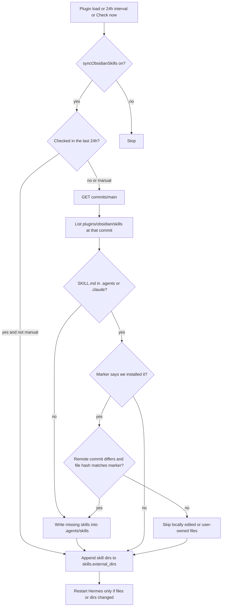

# Sync official Obsidian skills into the vault

> **For agentic workers:** REQUIRED SUB-SKILL: Use superpowers:subagent-driven-development (recommended) or superpowers:executing-plans to implement this plan task-by-task. Steps use checkbox (`- [ ]`) syntax for tracking.

**Goal:** On vault load, Hermes Studio installs any missing official Obsidian skills from `obsidianmd/obsidian-skills` into the vault and registers the folder with Hermes. About once a day it updates only the copies it installed, and leaves locally edited files alone.

**Architecture:** A sync module fetches the skill tree from GitHub and writes missing skills through the vault adapter. A marker file records the commit and a sha256 per installed file. A small YAML editor appends those directories to `skills.external_dirs` without rewriting the rest of `~/.hermes/config.yaml`. The plugin starts the sync after Hermes is activated and restarts Hermes only when a skill file or that list changes.

**Tech Stack:** TypeScript, Obsidian vault adapter, Node.js `fs` for `~/.hermes/config.yaml`, Vitest with a fake GitHub client.

## Status

- [x] Add `obsidian-skills-sync`: GitHub tree fetch, vault install, marker, hash-guarded updates
- [x] Append vault skill dirs to `skills.external_dirs` without rewriting the rest of `config.yaml`
- [x] Hook onload, 24h interval, settings toggle, Check now command, and conditional Hermes restart
- [x] Cover install, existing `.claude` copies, update, local edits, network failure, and YAML append
- [x] Correct the README security section for this fetch and vault write

## Decision

Install missing skills under the vault at `.agents/skills/<skill-name>/`, which is the cross-tool directory Hermes already understands. Register that directory (and `.claude/skills` when a skill already lives there) on `skills.external_dirs` in `~/.hermes/config.yaml`, so Hermes loads them even when the vault is not a trusted git repo. The same resolved path is deduped if Hermes also sees it as a project skill.

Official skills today live at `plugins/obsidian/skills/` in [obsidianmd/obsidian-skills](https://github.com/obsidianmd/obsidian-skills): `obsidian-markdown`, `obsidian-bases`, `json-canvas`, `obsidian-cli`, `obsidian-headless`, `defuddle`, and `knap`. Discover that list from the repo tree at sync time so new upstream skills are picked up. Do not shell out to `npx skills`.

A skill counts as already installed when `SKILL.md` exists at either `.agents/skills/<name>/SKILL.md` or `.claude/skills/<name>/SKILL.md`. An existing `.claude/skills` copy is left in place and is not copied.

## Sync flow

Freshness is the `main` commit SHA, not the plugin version in that repo. Unauthenticated GitHub: one commit request on the steady path, plus one recursive git tree and raw file reads only when the SHA changed or a skill is missing.

## Ownership and updates

Write a marker through the vault adapter at `.agents/skills/.hermes-studio-obsidian-skills.json` recording the commit SHA and a sha256 per installed file. Plugin data only stores `checkedAt` for the throttle.

- Missing skill: download every file under that skill directory and record hashes.
- Marker-owned file whose current hash still matches: replace it when the remote commit changes.
- Marker-owned file whose hash differs, or a skill with no marker: leave it and mention it in the notice.
- Same commit and every expected `SKILL.md` present: no file writes.

Vault writes go through `app.vault.adapter` (`mkdir`, `write`), including the dot-directory. `~/.hermes/config.yaml` stays on `node:fs`, which is the existing home-directory exception in [README.md](README.md).

## Hermes registration

Add a small comment-preserving editor, [src/host/hermes-external-skills.ts](src/host/hermes-external-skills.ts). It appends absolute paths to `skills.external_dirs` and does not rewrite the rest of the file. Cover these shapes in tests: key missing, `external_dirs: []`, block list, flow list, path already present. If that key cannot be updated safely, leave the file untouched and say so in the notice. Skills on disk still count as installed.

Resolve Hermes home from `HERMES_HOME` or `~/.hermes`. Hermes caches `external_dirs` in the running process, so call the existing restart command only when a skill file or the external-dir list actually changed.

## Plugin wiring

New module [src/host/obsidian-skills-sync.ts](src/host/obsidian-skills-sync.ts) with an injected HTTP client so tests do not hit GitHub. [src/main.ts](src/main.ts) starts the sync after the core is activated, without blocking `onload`. Failures become a notice; they do not break plugin startup.

In [src/settings.ts](src/settings.ts):

- `syncObsidianSkills` toggle, default `true`
- Button "Check Obsidian skills now" that bypasses the 24h throttle
- `registerInterval` of 24h while Obsidian is open
- Command alongside the existing skill commands

Update the security section of [README.md](README.md): this plugin fetches `obsidianmd/obsidian-skills` and writes `.agents/skills/` through the vault adapter, and it appends those directories to `skills.external_dirs`.

## Tests

[tests/obsidian-skills-sync.test.ts](tests/obsidian-skills-sync.test.ts) and [tests/hermes-external-skills.test.ts](tests/hermes-external-skills.test.ts), using a temp vault and a fake GitHub client:

- Nothing installed: all skills land under `.agents/skills` and the marker records hashes
- `.claude/skills/<name>/SKILL.md` present: that skill is not copied; `.claude/skills` is registered
- Same commit: no writes
- New commit, untouched managed file: file replaced
- New commit, locally edited managed file: file kept
- Network error: vault and config unchanged, sync reports failure
- `external_dirs` append is idempotent and leaves surrounding YAML in place
