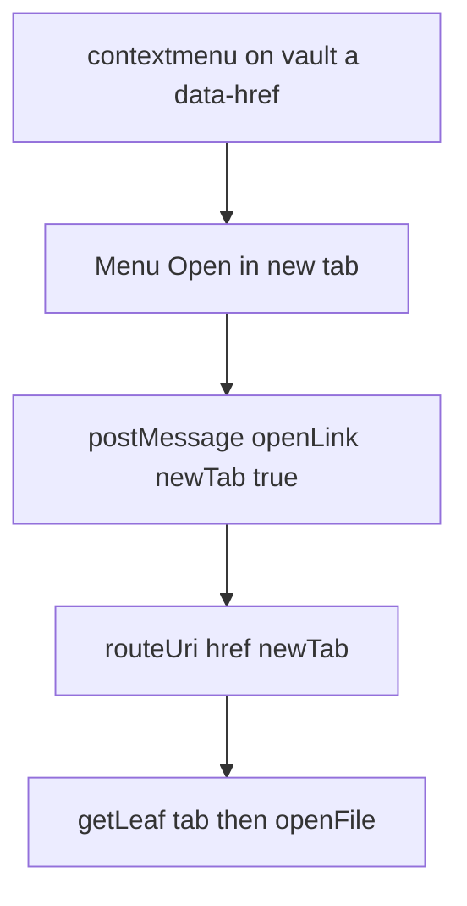

# Open note in a new tab from the chat context menu

> **For agentic workers:** REQUIRED SUB-SKILL: Use superpowers:subagent-driven-development (recommended) or superpowers:executing-plans to implement this plan task-by-task. Steps use checkbox (`- [ ]`) syntax for tracking.

**Goal:** Right-clicking a vault note link in the main Hermes chat webview opens a context menu whose only item opens that note in a new Obsidian tab.

**Architecture:** A small listener on the webview shadow root catches `contextmenu` on vault `a[data-href]` links and posts the existing `openLink` message with `newTab: true`. `resolveVaultClick` forwards that flag to `VaultDocumentRouter.routeUri`. With the flag, `routeUri` skips the existing-leaf reuse and opens the file on `workspace.getLeaf("tab")`. Left click stays on the current path: no flag, reuse an open leaf, otherwise replace the active leaf.

**Tech Stack:** TypeScript, the Hermes chat shadow root in `src/webview/webview-mount.ts`, Vitest with jsdom. Do not edit `src/webview/webview-runtime.cjs`.

## Global Constraints

- Do not create a git commit unless the user explicitly asks.
- Left click on a note link still posts `{ type: "openLink", href }` with no `newTab`, and `routeUri` without `newTab` still focuses an already-open leaf before replacing the active leaf.
- The menu label is the English string `Open in new tab`, matching the rest of the webview.
- The menu appears only for vault navigation hrefs: `wikilink://`, `obsidian://`, `file://`, or a href that is not an `scheme://` URL. `https://` and other external schemes keep the browser menu.
- `newTab` always calls `getLeaf("tab")` and `openFile` on that leaf, even when the note is already open in another leaf.
- Folders still only reveal in the file explorer. External files and tool-step path buttons are out of scope.
- The minified chat bundle is not modified. Click handling already inside `Ld` stays as it is.

---

## File structure

- Create `src/webview/vault-link-context-menu.ts`. Owns the menu DOM, the vault-href check, and the `contextmenu` listener. No Obsidian import.
- Create `tests/vault-link-context-menu.test.ts`. Shadow-root unit test for that module.
- Modify `src/webview/webview-mount.ts`. Attach the menu on `rootEl` and dispose it in `destroy`.
- Modify `src/host/vault-click-port.ts`. Pass `{ newTab: true }` into `routeUri` when the message says so.
- Modify `tests/vault-click-port.test.ts`. Assert the flag is forwarded and that a plain `openLink` still calls `routeUri` with one argument.
- Modify `src/host/vault-document-router.ts`. Add `newTab?: boolean` to `routeUri` and branch the leaf choice.
- Modify `tests/vault-document-router.test.ts`. Assert a forced new tab does not reuse the leaf that already shows the note.



---

### Task 1: Context menu on vault note links

**Files:**
- Create: `src/webview/vault-link-context-menu.ts`
- Test: `tests/vault-link-context-menu.test.ts`

**Interfaces:**
- Consumes: nothing from later tasks.
- Produces: `attachVaultLinkContextMenu(root: HTMLElement, postMessage: (msg: { type: "openLink"; href: string; newTab: true }) => void): () => void`. Calling the returned function removes the listener and the menu node.

- [ ] **Step 1: Write the failing test**

```ts
// @vitest-environment jsdom

import { describe, expect, it, vi } from "vitest";
import { attachVaultLinkContextMenu } from "../src/webview/vault-link-context-menu";

function mount() {
  const host = document.createElement("div");
  const shadow = host.attachShadow({ mode: "open" });
  const root = document.createElement("div");
  const vault = document.createElement("a");
  vault.setAttribute("data-href", "wikilink://AI%2FAI.md");
  vault.textContent = "AI";
  const external = document.createElement("a");
  external.setAttribute("data-href", "https://example.com");
  external.textContent = "Example";
  root.append(vault, external);
  shadow.append(root);
  document.body.append(host);
  const postMessage = vi.fn();
  const dispose = attachVaultLinkContextMenu(root, postMessage);
  return { root, vault, external, postMessage, dispose };
}

describe("attachVaultLinkContextMenu", () => {
  it("opens a new-tab item for a vault link and posts openLink", () => {
    const { root, vault, postMessage, dispose } = mount();

    vault.dispatchEvent(new MouseEvent("contextmenu", { bubbles: true, cancelable: true, clientX: 12, clientY: 24 }));

    const item = root.querySelector("button");
    expect(item?.textContent).toBe("Open in new tab");
    item?.dispatchEvent(new MouseEvent("click", { bubbles: true }));

    expect(postMessage).toHaveBeenCalledWith({
      type: "openLink",
      href: "wikilink://AI%2FAI.md",
      newTab: true,
    });
    expect(root.querySelector("button")).toBeNull();
    dispose();
  });

  it("leaves https links to the browser menu", () => {
    const { root, external, postMessage, dispose } = mount();
    const event = new MouseEvent("contextmenu", { bubbles: true, cancelable: true });

    external.dispatchEvent(event);

    expect(event.defaultPrevented).toBe(false);
    expect(root.querySelector("button")).toBeNull();
    expect(postMessage).not.toHaveBeenCalled();
    dispose();
  });

  it("does not intercept a left click", () => {
    const { vault, postMessage, dispose } = mount();

    vault.dispatchEvent(new MouseEvent("click", { bubbles: true, cancelable: true }));

    expect(postMessage).not.toHaveBeenCalled();
    dispose();
  });
});
```

- [ ] **Step 2: Run the test and confirm it fails**

Run: `npx vitest run tests/vault-link-context-menu.test.ts`

Expected: FAIL because `../src/webview/vault-link-context-menu` does not exist.

- [ ] **Step 3: Implement the menu**

```ts
export interface VaultLinkOpenMessage {
  type: "openLink";
  href: string;
  newTab: true;
}

const MENU_CLASS = "hermes-vault-link-menu";

function isVaultNavigationHref(href: string): boolean {
  return (
    href.startsWith("obsidian://") ||
    href.startsWith("file://") ||
    href.startsWith("wikilink://") ||
    !/^[a-z][a-z0-9+.-]*:/i.test(href)
  );
}

function closestVaultLink(root: HTMLElement, target: EventTarget | null): HTMLElement | null {
  if (!(target instanceof Element)) return null;
  const link = target.closest<HTMLElement>("[data-href]");
  if (!link || !root.contains(link)) return null;
  const href = link.dataset.href ?? "";
  return href && isVaultNavigationHref(href) ? link : null;
}

export function attachVaultLinkContextMenu(
  root: HTMLElement,
  postMessage: (msg: VaultLinkOpenMessage) => void,
): () => void {
  const doc = root.ownerDocument;
  let menu: HTMLElement | null = null;

  const close = () => {
    menu?.remove();
    menu = null;
  };

  const onContextMenu = (event: Event) => {
    const mouse = event as MouseEvent;
    const link = closestVaultLink(root, mouse.target);
    if (!link) return;
    mouse.preventDefault();
    close();

    menu = doc.createElement("div");
    menu.className = MENU_CLASS;
    menu.style.left = `${mouse.clientX}px`;
    menu.style.top = `${mouse.clientY}px`;
    const item = doc.createElement("button");
    item.type = "button";
    item.textContent = "Open in new tab";
    item.addEventListener("click", () => {
      postMessage({ type: "openLink", href: link.dataset.href ?? "", newTab: true });
      close();
    });
    menu.append(item);
    root.append(menu);
  };

  const onPointerDown = (event: Event) => {
    if (!menu || !(event.target instanceof Node) || menu.contains(event.target)) return;
    close();
  };

  const onKeyDown = (event: Event) => {
    if ((event as KeyboardEvent).key === "Escape") close();
  };

  root.addEventListener("contextmenu", onContextMenu);
  root.addEventListener("pointerdown", onPointerDown);
  root.addEventListener("scroll", close, true);
  doc.addEventListener("keydown", onKeyDown);

  if (!doc.getElementById("hermes-vault-link-menu-style")) {
    const style = doc.createElement("style");
    style.id = "hermes-vault-link-menu-style";
    style.textContent = `
      .${MENU_CLASS} {
        position: fixed;
        z-index: 50;
        min-width: 11rem;
        padding: 4px;
        border: 1px solid var(--vscode-editorWidget-border, #334155);
        border-radius: 6px;
        background: var(--vscode-editorWidget-background, #1e293b);
        box-shadow: var(--vscode-widget-shadow, rgba(0, 0, 0, 0.45));
      }
      .${MENU_CLASS} button {
        display: block;
        width: 100%;
        padding: 4px 8px;
        border: 0;
        border-radius: 4px;
        background: transparent;
        color: var(--vscode-foreground, #e2e8f0);
        font: inherit;
        text-align: left;
        cursor: pointer;
      }
      .${MENU_CLASS} button:hover {
        background: var(--vscode-list-hoverBackground, rgba(255, 255, 255, 0.08));
      }
    `;
    (root.getRootNode() instanceof ShadowRoot ? root.getRootNode() : doc.head).appendChild(style);
  }

  return () => {
    close();
    root.removeEventListener("contextmenu", onContextMenu);
    root.removeEventListener("pointerdown", onPointerDown);
    root.removeEventListener("scroll", close, true);
    doc.removeEventListener("keydown", onKeyDown);
  };
}
```

The style node goes into the shadow root when `root` lives there, so the menu is styled inside the chat webview. `pointerdown` on the menu button happens before `click`, and the guard `menu.contains(event.target)` keeps that press from closing the menu first.

- [ ] **Step 4: Run the test and confirm it passes**

Run: `npx vitest run tests/vault-link-context-menu.test.ts`

Expected: PASS, 3 tests.

---

### Task 2: Attach the menu when the webview mounts

**Files:**
- Modify: `src/webview/webview-mount.ts`

**Interfaces:**
- Consumes: `attachVaultLinkContextMenu` from Task 1.
- Produces: every mounted chat webview shows the menu. `destroy()` removes it before clearing the shadow root.

- [ ] **Step 1: Wire the listener**

In `src/webview/webview-mount.ts`, import `attachVaultLinkContextMenu` and, after `createHermesWebviewInstance` returns, attach it to `rootEl`. The post callback is the same `onMessageFromWebview` the runtime already uses for left clicks.

```ts
import { attachVaultLinkContextMenu } from "./vault-link-context-menu";
```

After the `runtime` const:

```ts
const disposeVaultLinkMenu = attachVaultLinkContextMenu(rootEl, (msg) => {
  onMessageFromWebview(msg);
});
```

Inside `destroy()`, call `disposeVaultLinkMenu()` before `shadowRoot.replaceChildren()`.

- [ ] **Step 2: Confirm the existing chat click test still passes**

Run: `npx vitest run tests/plugin-lifecycle.test.ts tests/theme-bridge.test.ts`

Expected: PASS. Left click on linkified notes still opens the note in the current leaf. No assertion in those files looks for the context menu.

---

### Task 3: Forward `newTab` from the webview message

**Files:**
- Modify: `src/host/vault-click-port.ts`
- Test: `tests/vault-click-port.test.ts`

**Interfaces:**
- Consumes: the message shape `{ type: "openLink"; href: string; newTab: true }` from Task 1.
- Produces: `VaultClickRouter.routeUri` accepts `options?: { selection?: { startLine: number; endLine: number }; newTab?: boolean }`. An `openLink` with `newTab: true` calls `routeUri(href, { newTab: true })`. An `openLink` without the flag still calls `routeUri(href)`.

- [ ] **Step 1: Write the failing test**

Add this case to `describe("resolveVaultClick")` in `tests/vault-click-port.test.ts`:

```ts
it("forwards newTab on openLink and omits it otherwise", async () => {
  const routeUri = vi.fn(async () => true);
  const clickRouter = router({ routeUri });

  await resolveVaultClick(
    { type: "openLink", href: "wikilink://Note", newTab: true },
    clickRouter,
  );
  await resolveVaultClick({ type: "openLink", href: "wikilink://Note" }, clickRouter);

  expect(routeUri).toHaveBeenNthCalledWith(1, "wikilink://Note", { newTab: true });
  expect(routeUri).toHaveBeenNthCalledWith(2, "wikilink://Note");
});
```

- [ ] **Step 2: Run the test and confirm it fails**

Run: `npx vitest run tests/vault-click-port.test.ts`

Expected: FAIL. The first call is `routeUri("wikilink://Note")` with one argument.

- [ ] **Step 3: Pass the flag through**

Widen the options on `VaultClickRouter.routeUri` with `newTab?: boolean`. In the `openLink` branch of `resolveVaultClick`:

```ts
if (msg?.type === "openLink" && msg.href) {
  if (isVaultNavigationHref(msg.href)) {
    const opened = await router.routeUri(
      msg.href,
      msg.newTab === true ? { newTab: true } : undefined,
    );
    if (opened) return { disposition: "handled" };
  }
  return { disposition: "forward" };
}
```

Leave `openFile` unchanged. It does not grow a `newTab` flag in this plan.

- [ ] **Step 4: Run the test and confirm it passes**

Run: `npx vitest run tests/vault-click-port.test.ts`

Expected: PASS.

---

### Task 4: Open the note on a new leaf

**Files:**
- Modify: `src/host/vault-document-router.ts` (`routeUri`, around the leaf choice at the current lines 661–673, and the `openLinkText` fallback near line 730)
- Test: `tests/vault-document-router.test.ts`

**Interfaces:**
- Consumes: `routeUri(href, { newTab: true })` from Task 3. The existing `selection` option stays.
- Produces: `routeUri(filePathOrLink, options?: { selection?: DocumentSelection; newTab?: boolean })`. When `options.newTab` is true and the target is a file, the router calls `this.host.getLeaf("tab")`, then `openFile` on that leaf, and does not call `findLeafForFilePath`. The `openLinkText` fallback receives `true` as its third argument only when `newTab` is set.

- [ ] **Step 1: Write the failing test**

Add this case inside `describe("routeUri")` in `tests/vault-document-router.test.ts`:

```ts
it("opens a new tab even when the note is already open", async () => {
  const { router, openedFiles, openLeaves, activeLeaves, hostAdapter } = createTestHarness();

  await router.routeUri("wikilink://Meus%20Documentos");
  const existing = openLeaves[0];
  const kinds: unknown[] = [];
  const original = hostAdapter.getLeaf!;
  hostAdapter.getLeaf = (kind?: unknown) => {
    kinds.push(kind);
    return original(kind);
  };

  const res = await router.routeUri("Meus Documentos.md", { newTab: true });

  expect(res).toBe(true);
  expect(kinds).toEqual(["tab"]);
  expect(openLeaves).toHaveLength(2);
  expect(existing.view.file?.path).toBe("Meus Documentos.md");
  expect(openLeaves[1].view.file?.path).toBe("Meus Documentos.md");
  expect(openedFiles).toHaveLength(2);
  expect(activeLeaves.at(-1)).toBe(openLeaves[1]);
});
```

The harness `getLeaf` already pushes each created leaf onto `openLeaves` and ignores its argument, so recording `kind` is enough to prove the router asked for `"tab"`.

- [ ] **Step 2: Run the test and confirm it fails**

Run: `npx vitest run tests/vault-document-router.test.ts -t "opens a new tab even when the note is already open"`

Expected: FAIL. Today the second `routeUri` reuses `existing`, so `kinds` is empty and `openLeaves` stays length 1.

- [ ] **Step 3: Branch the leaf choice**

Change the options parameter of `routeUri` to:

```ts
options?: { selection?: DocumentSelection; newTab?: boolean },
```

Replace the leaf selection that currently always starts with `findLeafForFilePath` with:

```ts
const targetMode = selection ? "source" : "preview";

// A new-tab request must not focus a leaf that already shows this note.
let leaf: any = options?.newTab ? null : this.findLeafForFilePath(abstractFile.path);

if (!leaf) {
  leaf = options?.newTab
    ? this.host.getLeaf?.("tab")
    : (this.host.getActiveLeaf?.() ??
      this.host.getMostRecentLeaf?.() ??
      this.host.getLeaf?.(false));

  if (leaf && typeof leaf.openFile === "function") {
    await leaf.openFile(abstractFile, {
      active: true,
      state: { mode: targetMode },
    });
  }
}
```

Keep the `revealLeaf`, `setActiveLeaf`, mode, and cursor block that already follows this `if`. In the `openLinkText` fallback, change the third argument from `false` to `Boolean(options?.newTab)`.

Do not change the folder branch. A folder target returns before the leaf choice.

- [ ] **Step 4: Run the router tests**

Run: `npx vitest run tests/vault-document-router.test.ts`

Expected: PASS, including the existing cases "reuses existing tab", "focuses the existing tab when a blank tab is active", and "replaces active note in current leaf without opening a new tab".

- [ ] **Step 5: Run the full suite**

Run: `npm test`

Expected: PASS. No commit.

---

## Out of scope

- A second menu item, a Portuguese label, or Obsidian's native `Menu`.
- `newTab` on `{ type: "openFile" }` tool-step path buttons.
- Changing what left click does when the note is already open.
- Splitting the leaf to the right (`getLeaf("split")`) or opening a new window.
