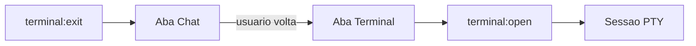

# Fonte, ícone e sessão nova no Terminal

> **For agentic workers:** REQUIRED SUB-SKILL: Use superpowers:subagent-driven-development (recommended) or superpowers:executing-plans to implement this plan task-by-task. Steps use checkbox (`- [ ]`) syntax for tracking.

**Goal:** Configurar o tamanho da fonte do terminal, mostrar um ícone na aba Terminal, e voltar para Chat quando o shell termina. A próxima visita à aba abre um shell novo.

**Architecture:** A fonte vive em `terminalFontSize` e chega ao xterm por uma mensagem do host, porque o painel não lê as settings. O ícone entra no switch `gv` do bundle, que já desenha o ícone da aba pelo id. No `terminal:exit` o painel limpa o xterm, clica em `#hs-tab-chat` e esquece a sessão; a volta à aba manda `terminal:open` de novo, e `open()` sobe um processo quando não há nenhum vivo.

**Tech Stack:** TypeScript, `src/webview/webview-runtime.cjs`, `@xterm/xterm`, Vitest com jsdom.

## Global Constraints

- O commit da aba Terminal e da opção `terminalShell` já está feito. Estas três mudanças ficam fora dele.
- `terminalFontSize` começa em `13` e fica entre 8 e 32. Trocar a fonte não reinicia o shell.
- O ícone usa o mesmo SVG de 16px das outras abas. O traço é um prompt: `M3 4.5l4 3.5-4 3.5M9 12h4`.
- `terminal:exit` volta para Chat e não imprime o banner de saída. `terminal:error` permanece na aba, para a mensagem de `python3` ausente continuar visível. A tecla que reinicia o shell fica só para esse erro.
- Um shell que morre com o usuário já em Chat não troca a aba de novo. `setTab` ignora o clique quando Chat já está selecionada.

## File structure

- Modify `src/settings.ts`. Add `terminalFontSize` and a text setting under Terminal shell.
- Modify `src/views/hermes-chat-view.ts`. After `mountShadowUi()`, post `{ type: "terminal:fontSize", size }`.
- Modify `src/main.ts`. When `saveSettings("terminalFontSize")` runs, post that message to the side view and the editor view.
- Modify `src/webview/terminal-panel.ts`. Apply `options.fontSize` and refit. On `terminal:exit`, reset the buffer, clear the announced session, and click `#hs-tab-chat`.
- Modify `src/webview/webview-runtime.cjs`. Add a `terminal` arm in `gv`.
- Modify `tests/terminal-tab.test.ts`. Expect the prompt path, and cover exit-to-Chat plus a second `terminal:open`.

## Tasks

- [ ] Add `terminalFontSize` (default 13, clamp 8–32) and apply it to the live xterm.
- [ ] Add the prompt icon for the `terminal` name in the tab icon switch.
- [ ] On shell exit, switch to Chat and start a new shell the next time Terminal is opened.

## Tests

- Post `{ type: "terminal:fontSize", size: 18 }` before opening the tab and expect the layer to use that size. A later message updates the open xterm and refits.
- `#hs-tab-terminal` contains an SVG path `M3 4.5l4 3.5-4 3.5M9 12h4`.
- Post `terminal:exit`: Chat is selected and `#hermes-terminal-layer` is hidden. Click Terminal and expect a second `terminal:open`.
