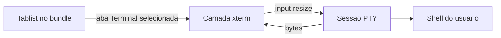

# Aba Terminal no Hermes Studio

> **For agentic workers:** REQUIRED SUB-SKILL: Use superpowers:subagent-driven-development (recommended) or superpowers:executing-plans to implement this plan task-by-task. Steps use checkbox (`- [ ]`) syntax for tracking.

**Goal:** Adicionar a aba Terminal ao lado de Chat, Learning, Memory, Capabilities e Agents, com um shell interativo de verdade (o shell padrão do usuário) dentro do painel do Hermes Studio.

**Architecture:** A aba entra no array `ms` do bundle do webview, com um marcador vazio no painel para não cair em Agents. O xterm fica numa camada irmã de `#app`, porque o Svelte desmonta o painel ao voltar para Chat. O processo é um PTY criado por um helper `python3` (`pty.fork`), uma sessão por view.

**Tech Stack:** TypeScript, o bundle gerado em `src/webview/webview-runtime.cjs`, `@xterm/xterm`, `@xterm/addon-fit`, `child_process` + `python3`, Vitest com jsdom.

## Global Constraints

- Um shell por view do Hermes (sidebar e aba do editor são sessões separadas). A sessão continua viva ao trocar para Chat ou Learning, e encerra quando a view fecha.
- Diretório inicial: raiz do vault. Shell: a opção `terminalShell` do plugin. O valor inicial é `/bin/sh` no Linux e no macOS (no macOS o Terminal.app costuma usar `/bin/zsh`, e o usuário troca o caminho se quiser). No Windows o valor inicial é `cmd.exe` (`ComSpec`), mas a aba não abre um shell lá porque o PTY é POSIX. A opção é lida de novo a cada start. Dentro do Flatpak, um caminho que existe no sandbox (como `/bin/sh`) roda localmente; um caminho que não existe no sandbox sobe com `flatpak-spawn --host`.
- Sem vários terminais, split ou perfis. `createTerminal` em `src/host/terminal-runner.ts` continua abrindo um emulador externo só para os fluxos que já o usam.
- Sem `node-pty`. No Linux e no macOS o helper usa `pty.fork()` e `TIOCSWINSZ`. Sem `python3`, ou no Windows, o painel mostra o motivo e não abre um pipe que finja ser terminal.
- Mensagens `terminal:*` são tratadas na view, antes do `receiveEmitter`.

## File structure

- Modify `src/webview/webview-runtime.cjs`. Add `{ id: "terminal", label: "Terminal" }` to `ms`. In `Pb`, branch on `terminal` before the panels check and render an empty `#hs-terminal-marker`.
- Create `src/host/integrated-terminal.ts`. One PTY session. `spawn` of `python3` with the helper embedded in the module. stdin is the keyboard, stdout is shell output, the extra fd receives `resize COLS ROWS`. `open` on a live session only resizes. `dispose` kills the process group.
- Create `src/webview/terminal-panel.ts`. xterm + fit addon in `#hermes-terminal-layer`, shown only while `#hs-tab-terminal` is `aria-selected="true"`.
- Modify `src/webview/webview-mount.ts` and `src/webview/theme-bridge.ts`. Mount the layer and style it under the tab list.
- Modify `src/views/hermes-chat-view.ts`. Own the session and dispose it on close.
- Create `tests/integrated-terminal.test.ts` and `tests/terminal-tab.test.ts`.

## Tasks

- [x] Include the Terminal tab in `ms` and an empty `Pb` branch.
- [x] Implement the PTY session and the fake-spawn tests. No real `python3` in the test.
- [x] Mount xterm, wire `terminal:*` messages, and cover the tab with a DOM test: the Terminal button sits with the others, click selects it, and the layer becomes visible.

## Tests

- Mount the webview the same way as `tests/theme-bridge.test.ts`. The Terminal button has `role="tab"`. Clicking it sets `aria-selected` and shows the layer.
- The PTY session receives a fake `spawn`: input goes to stdin, stdout chunks become terminal data, resize writes the control fd, and `dispose` ends the child.
