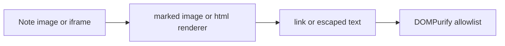

# Embed Obsidian YouTube links in generated HTML

> **For agentic workers:** REQUIRED SUB-SKILL: Use superpowers:subagent-driven-development (recommended) or superpowers:executing-plans to implement this plan task-by-task. Steps use checkbox (`- [ ]`) syntax for tracking.

**Goal:** When assistant markdown is turned into chat HTML, an Obsidian YouTube embed becomes a player instead of a link or escaped text.

**Architecture:** A pure parser recognizes YouTube watch, short, live, embed, and `youtu.be` URLs and returns one locked-down `youtube-nocookie` iframe. The bundled markdown renderer calls that parser from its image and raw-HTML hooks. DOMPurify may keep an iframe only when the src is exactly the URL the parser built. Every other image stays a link, and every other raw tag stays escaped.

**Tech Stack:** TypeScript, the existing `marked` renderer and DOMPurify allowlist inside `src/webview/webview-runtime.cjs`, Vitest with jsdom.

## Global Constraints

- Do not create a git commit unless the user explicitly asks.
- Only YouTube. Leave Twitter and every other image embed as the current link.
- Never copy the original query string into the iframe. Rebuild `src` from the video id and an optional numeric `start`.
- A video id must match `/^[A-Za-z0-9_-]{11}$/`.
- The only allowed iframe origin is `https://www.youtube-nocookie.com/embed/`.
- A raw HTML snippet becomes a player only when the whole snippet is one iframe whose `src` is a YouTube URL. Anything with a second tag, including `<script>`, stays escaped.
- Other markdown images stay `<a href="...">image: ...</a>` or `<a href="...">image</a>`.

---

## File structure

- Create `src/webview/youtube-embed.ts`. Owns URL parsing and the iframe HTML string. No DOM, no Obsidian imports.
- Create `tests/youtube-embed.test.ts`. Unit tests for that parser.
- Modify `src/webview/webview-mount.ts`. Pass the two parser functions into the runtime env, next to `linkifyVaultText`.
- Modify `src/webview/webview-runtime.cjs` around the `Ng` renderer (the `html` and `image` methods near line 16067), the `afterSanitizeAttributes` hook, and the `Pg` allowlist. This file is the generated chat bundle; edit those three sites in place. Do not reformat the rest of the file.
- Modify `src/webview/theme-bridge.ts`. Add the `.yt-embed` size rule to `THEME_BRIDGE_CSS`.
- Modify `tests/theme-bridge.test.ts`. Mount the real webview and assert the sanitizer kept the player.

## Why the player disappears

Obsidian stores a YouTube embed as an external image:

```md

```

Some notes instead contain a raw `<iframe src="https://www.youtube.com/embed/...">`. Assistant items (`kind: "assistant"`) go through `Fg.render` / `Lg` in `src/webview/webview-runtime.cjs`. That renderer does three things that drop the video:

- `image` always returns `<a href="...">image</a>`.
- `html` always runs the text through `Og`, which escapes `<` and `>`.
- `Pg.ALLOWED_TAGS` has no `iframe`, so a player tag would be deleted even if one were emitted.



## Status

- [x] Parser and unit tests
- [x] Renderer hooks, sanitizer, mount, CSS, and webview test

### Task 1: YouTube embed parser

**Files:**
- Create: `src/webview/youtube-embed.ts`
- Test: `tests/youtube-embed.test.ts`

**Interfaces:**
- Consumes: nothing
- Produces:
  - `youtubeEmbedHtml(href: string): string | null`
  - `youtubeEmbedFromHtml(raw: string): string | null`

- [ ] **Step 1: Write the failing test**

Create `tests/youtube-embed.test.ts`:

```ts
import { describe, expect, it } from "vitest";
import { youtubeEmbedFromHtml, youtubeEmbedHtml } from "../src/webview/youtube-embed";

const ID = "dQw4w9WgXcQ";
const BASE = `https://www.youtube-nocookie.com/embed/${ID}?modestbranding=1&rel=0`;

describe("youtubeEmbedHtml", () => {
  it.each([
    `https://www.youtube.com/watch?v=${ID}`,
    `https://m.youtube.com/watch?v=${ID}`,
    `https://youtu.be/${ID}`,
    `https://www.youtube.com/shorts/${ID}`,
    `https://www.youtube.com/embed/${ID}`,
    `https://www.youtube.com/live/${ID}`,
    `https://www.youtube.com/v/${ID}`,
    `https://www.youtube-nocookie.com/embed/${ID}`,
  ])("embeds %s", (href) => {
    const html = youtubeEmbedHtml(href);
    expect(html).toContain(`src="${BASE}"`);
    expect(html).toContain('class="yt-embed"');
    expect(html).not.toContain("youtube.com/watch");
    expect(html).not.toContain("autoplay");
  });

  it("maps t and start onto a numeric start parameter", () => {
    expect(youtubeEmbedHtml(`https://www.youtube.com/watch?v=${ID}&t=90`)).toContain(
      `${BASE}&start=90`,
    );
    expect(youtubeEmbedHtml(`https://youtu.be/${ID}?t=1m30s`)).toContain(`${BASE}&start=90`);
    expect(youtubeEmbedHtml(`https://www.youtube.com/watch?v=${ID}&start=1h2m3s`)).toContain(
      `${BASE}&start=3723`,
    );
  });

  it("drops every other query parameter", () => {
    const html = youtubeEmbedHtml(
      `https://www.youtube.com/watch?v=${ID}&autoplay=1&origin=https://evil.test`,
    );
    expect(html).toContain(`src="${BASE}"`);
    expect(html).not.toContain("evil.test");
    expect(html).not.toContain("autoplay");
  });

  it.each([
    "https://example.com/watch?v=dQw4w9WgXcQ",
    "https://www.youtube.com/watch?v=short",
    "https://www.youtube.com/watch?v=dQw4w9WgXcQ/extra",
    "https://youtu.be/dQw4w9WgXcQ/extra",
    "javascript:alert(1)",
    "not a url",
    "",
  ])("rejects %s", (href) => {
    expect(youtubeEmbedHtml(href)).toBeNull();
  });
});

describe("youtubeEmbedFromHtml", () => {
  it("rebuilds a single YouTube iframe and drops its original attributes", () => {
    const html = youtubeEmbedFromHtml(
      `<iframe src="https://www.youtube.com/embed/${ID}" width="560" onload="alert(1)"></iframe>`,
    );
    expect(html).toContain(`src="${BASE}"`);
    expect(html).not.toContain("onload");
    expect(html).not.toContain("width=");
  });

  it("decodes an amp entity inside the iframe src", () => {
    const html = youtubeEmbedFromHtml(
      `<iframe src="https://www.youtube.com/embed/${ID}?t=90&amp;rel=1"></iframe>`,
    );
    expect(html).toContain(`${BASE}&start=90`);
    expect(html).not.toContain("rel=1");
  });

  it.each([
    `<iframe src="https://evil.example/"></iframe>`,
    `<iframe src="https://www.youtube.com/embed/${ID}"></iframe><script>alert(1)</script>`,
    `<p>https://www.youtube.com/watch?v=${ID}</p>`,
    ``,
  ])("rejects %s", (raw) => {
    expect(youtubeEmbedFromHtml(raw)).toBeNull();
  });
});
```

- [ ] **Step 2: Run the test to verify it fails**

Run: `npx vitest run tests/youtube-embed.test.ts`

Expected: FAIL because `src/webview/youtube-embed.ts` does not exist.

- [ ] **Step 3: Write the parser**

Create `src/webview/youtube-embed.ts`:

```ts
const YOUTUBE_ID_RE = /^[A-Za-z0-9_-]{11}$/;
const IFRAME_RE =
  /^<iframe\b([^>]*)>(?:\s*<\/iframe>)?\s*$/i;
const SRC_RE = /\bsrc\s*=\s*(?:"([^"]*)"|'([^']*)')/i;

function bareHost(host: string): string {
  return host.replace(/^(?:www|m|mobile)\./i, "").toLowerCase();
}

function startSeconds(value: string | null): number | undefined {
  if (!value) return undefined;
  if (/^\d+$/.test(value)) {
    const seconds = Number(value);
    return seconds > 0 ? seconds : undefined;
  }
  const match = /^(?:(\d+)h)?(?:(\d+)m)?(?:(\d+)s)?$/.exec(value);
  if (!match?.[0]) return undefined;
  const seconds = Number(match[1] || 0) * 3600 + Number(match[2] || 0) * 60 + Number(match[3] || 0);
  return seconds > 0 ? seconds : undefined;
}

function videoId(url: URL): string {
  const host = bareHost(url.hostname);
  const segments = url.pathname.split("/").filter(Boolean);
  if (host === "youtu.be") return segments[0] ?? "";
  if (host !== "youtube.com" && host !== "youtube-nocookie.com") return "";
  if (segments[0] === "watch") return url.searchParams.get("v") ?? "";
  if (segments[0] && ["embed", "shorts", "live", "v"].includes(segments[0])) {
    return segments[1] ?? "";
  }
  return "";
}

export function youtubeEmbedHtml(href: string): string | null {
  let url: URL;
  try {
    url = new URL(href);
  } catch {
    return null;
  }
  if (url.protocol !== "https:" && url.protocol !== "http:") return null;
  const id = videoId(url);
  if (!YOUTUBE_ID_RE.test(id)) return null;
  if (bareHost(url.hostname) === "youtu.be" && url.pathname.split("/").filter(Boolean).length !== 1) {
    return null;
  }

  const params = new URLSearchParams({ modestbranding: "1", rel: "0" });
  const start = startSeconds(url.searchParams.get("t") ?? url.searchParams.get("start"));
  if (start) params.set("start", String(start));
  const src = `https://www.youtube-nocookie.com/embed/${id}?${params.toString()}`;
  return `<div class="yt-embed"><iframe src="${src}" title="YouTube video" loading="lazy" allow="accelerometer; autoplay; clipboard-write; encrypted-media; gyroscope; picture-in-picture; web-share" allowfullscreen referrerpolicy="strict-origin-when-cross-origin"></iframe></div>`;
}

export function youtubeEmbedFromHtml(raw: string): string | null {
  const trimmed = raw.trim();
  if (/<script/i.test(trimmed)) return null;
  const iframe = IFRAME_RE.exec(trimmed);
  if (!iframe) return null;
  const srcMatch = SRC_RE.exec(iframe[1] ?? "");
  const src = (srcMatch?.[1] ?? srcMatch?.[2] ?? "").replace(/&amp;/g, "&");
  if (!src) return null;
  return youtubeEmbedHtml(src);
}
```

The extra `youtu.be` path-length check rejects `https://youtu.be/dQw4w9WgXcQ/extra`, which `videoId` would otherwise accept by reading only the first segment. `watch?v=ID/extra` is already rejected because the id regex fails.

- [ ] **Step 4: Run the test to verify it passes**

Run: `npx vitest run tests/youtube-embed.test.ts`

Expected: PASS.

### Task 2: Render the player in chat HTML

**Files:**
- Modify: `src/webview/webview-mount.ts` (the `createHermesWebviewInstance` call)
- Modify: `src/webview/webview-runtime.cjs` (`html`, `image`, `afterSanitizeAttributes`, `Pg`)
- Modify: `src/webview/theme-bridge.ts` (end of `THEME_BRIDGE_CSS`)
- Test: `tests/theme-bridge.test.ts`

**Interfaces:**
- Consumes: `youtubeEmbedHtml(href: string): string | null` and `youtubeEmbedFromHtml(raw: string): string | null` from Task 1
- Produces: those functions on the runtime env as `__env.youtubeEmbedHtml` and `__env.youtubeEmbedFromHtml`. The image and html renderers call them. DOMPurify keeps the resulting iframe only when its src matches `/^https:\/\/www\.youtube-nocookie\.com\/embed\/[A-Za-z0-9_-]{11}\?(?:modestbranding=1&rel=0(?:&start=\d+)?)$/`.

- [ ] **Step 1: Write the failing webview test**

Append this `it` inside the `"Shadow-DOM scoped Svelte 5 webview mount"` describe in `tests/theme-bridge.test.ts`. Copy the `meta` object from the existing init message in that file (`connection`, `busy`, `turn`, `queued`, `models`, `model`, `modes`, `skills`, `folder`).

```ts
it("embeds an Obsidian YouTube image and refuses other iframes", async () => {
  const hostEl = document.createElement("div");
  document.body.appendChild(hostEl);
  const shadowRoot = hostEl.attachShadow({ mode: "open" });
  const instance = mountHermesWebview({
    shadowRoot,
    place: "side",
    onMessageFromWebview: () => {},
  });

  instance.postMessageToWebview({
    type: "init",
    model: {
      items: [
        {
          id: "yt",
          kind: "assistant",
          turn: 1,
          text: [
            "",
            "",
            "",
            "",
            '<iframe src="https://evil.example/"></iframe>',
          ].join("\n"),
        },
      ],
      meta: {
        connection: { state: "ready" },
        busy: false,
        turn: 1,
        queued: [],
        models: [],
        model: "anthropic/claude-sonnet-4",
        modes: [],
        skills: [],
        folder: "Main_Vault",
      },
    },
  });

  await new Promise((r) => setTimeout(r, 40));

  const iframe = shadowRoot.querySelector("iframe");
  expect(iframe).not.toBeNull();
  expect(iframe!.getAttribute("src")).toBe(
    "https://www.youtube-nocookie.com/embed/dQw4w9WgXcQ?modestbranding=1&rel=0",
  );
  expect(iframe!.closest(".yt-embed")).not.toBeNull();

  const links = [...shadowRoot.querySelectorAll("a")].map((a) => a.getAttribute("data-href"));
  expect(links).toContain("https://example.com/photo.png");
  expect(shadowRoot.querySelector('iframe[src*="evil.example"]')).toBeNull();
  expect(shadowRoot.textContent).toContain("<iframe");

  expect(THEME_BRIDGE_CSS).toContain(".yt-embed");
  expect(THEME_BRIDGE_CSS).toContain("aspect-ratio: 16 / 9");

  instance.destroy();
  hostEl.remove();
});
```

`THEME_BRIDGE_CSS` is already imported in that test file. The escaped evil iframe is visible as the characters `<iframe` because `Og` turns the tag into text. The photo stays an anchor. The sanitizer moves `href` to `data-href`, which is why the assertion reads `data-href`.

- [ ] **Step 2: Run the test to verify it fails**

Run: `npx vitest run tests/theme-bridge.test.ts -t "embeds an Obsidian YouTube image"`

Expected: FAIL because no iframe is rendered (`iframe` is `null`).

- [ ] **Step 3: Pass the parser into the runtime**

In `src/webview/webview-mount.ts`, import the parser:

```ts
import { youtubeEmbedFromHtml, youtubeEmbedHtml } from "./youtube-embed";
```

Add both functions to the object passed to `createHermesWebviewInstance`, next to `linkifyVaultText`:

```ts
linkifyVaultText: options.linkifyVaultText,
youtubeEmbedHtml,
youtubeEmbedFromHtml,
```

- [ ] **Step 4: Call the parser from the markdown renderer**

In `src/webview/webview-runtime.cjs`, replace the `html` and `image` renderer methods with:

```js
html({ text: e }) {
  if (typeof __env?.youtubeEmbedFromHtml === `function`) {
    let embed = __env.youtubeEmbedFromHtml(e);
    if (typeof embed === `string` && embed.length > 0) return embed;
  }
  return Og(e);
},
image({ href: e, text: t }) {
  if (typeof e === `string` && typeof __env?.youtubeEmbedHtml === `function`) {
    let embed = __env.youtubeEmbedHtml(e);
    if (typeof embed === `string` && embed.length > 0) return embed;
  }
  let n = t.trim() ? `image: ${t}` : `image`;
  return `<a href="${Og(e)}">${Og(n)}</a>`;
},
```

In the same `afterSanitizeAttributes` callback, add this branch after the `CODE` branch and before the closing of the callback:

```js
else if (e.tagName === `IFRAME`) {
  let src = e.getAttribute(`src`) ?? ``;
  if (
    !/^https:\/\/www\.youtube-nocookie\.com\/embed\/[A-Za-z0-9_-]{11}\?(?:modestbranding=1&rel=0(?:&start=\d+)?)$/.test(
      src,
    )
  ) {
    e.remove();
  }
}
```

Add `iframe` to the `ALLOWED_TAGS` string, after `input`:

```js
`p.br.strong.em.del.code.pre.span.div.button.ul.ol.li.blockquote.h1.h2.h3.h4.h5.h6.a.hr.table.thead.tbody.tr.th.td.input.iframe`.split(
  `.`,
),
```

Add these names to `ALLOWED_ATTR`, after `aria-label`. `title` and `class` are already there. `start` is already there for ordered lists; the player uses `start` only as a query parameter, not as an attribute.

```js
`src`,
`allow`,
`allowfullscreen`,
`loading`,
`referrerpolicy`,
```

- [ ] **Step 5: Size the player**

Append this rule inside the `THEME_BRIDGE_CSS` template string in `src/webview/theme-bridge.ts`, before the closing backtick:

```css
.yt-embed {
  position: relative;
  display: block;
  width: 100%;
  max-width: 640px;
  margin: 0.75rem 0;
  aspect-ratio: 16 / 9;
}

.yt-embed iframe {
  position: absolute;
  inset: 0;
  width: 100%;
  height: 100%;
  border: 0;
}
```

- [ ] **Step 6: Run the webview test and the parser tests**

Run: `npx vitest run tests/youtube-embed.test.ts tests/theme-bridge.test.ts`

Expected: PASS, including the existing theme-bridge cases.

- [ ] **Step 7: Stop**

Do not commit. Leave the working tree for the user to review.
